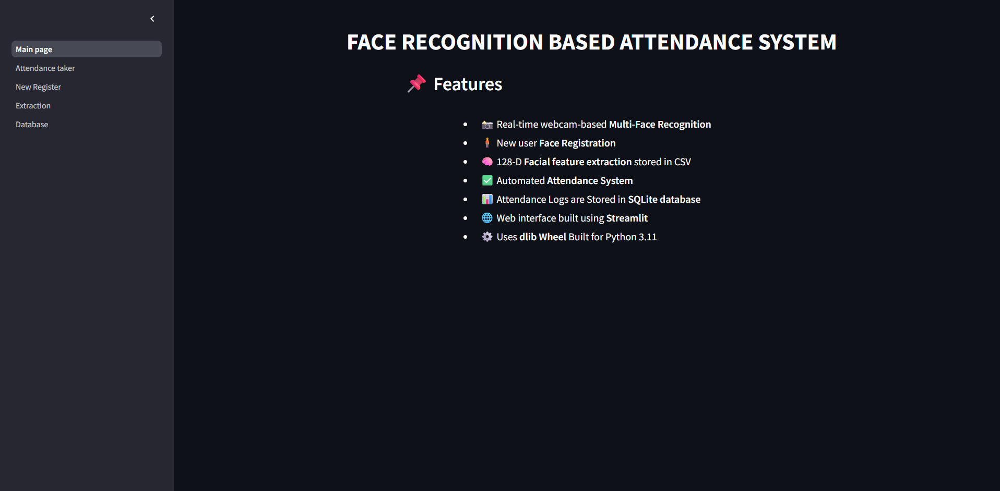
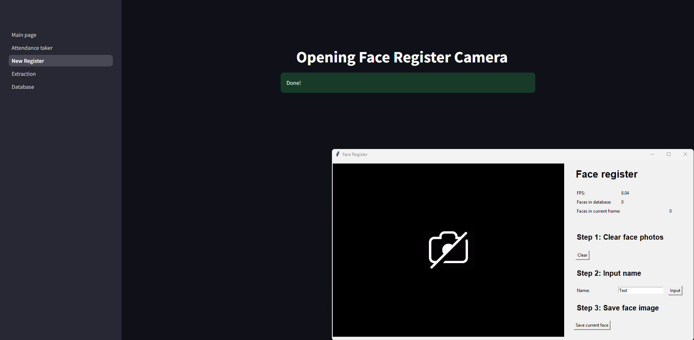
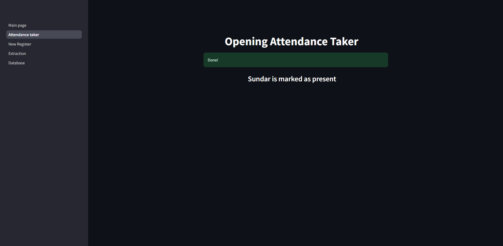
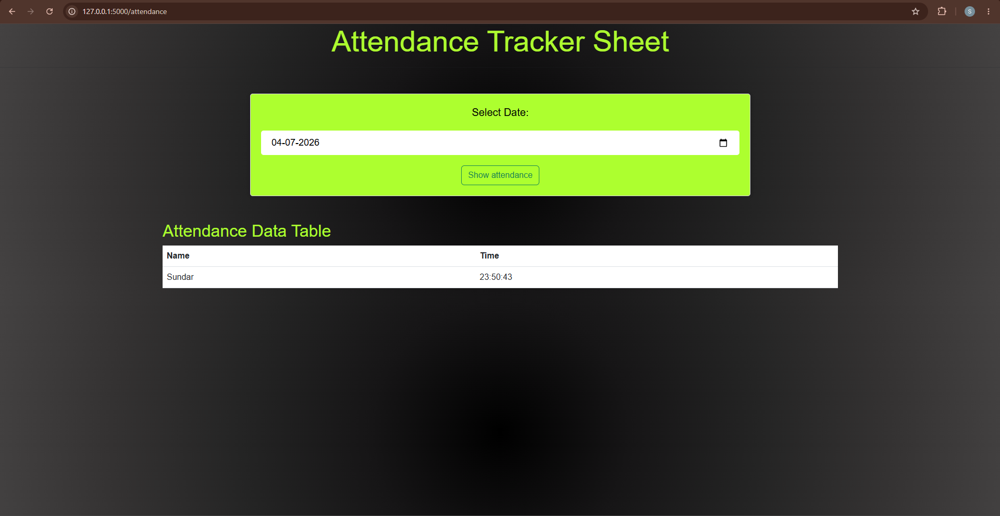
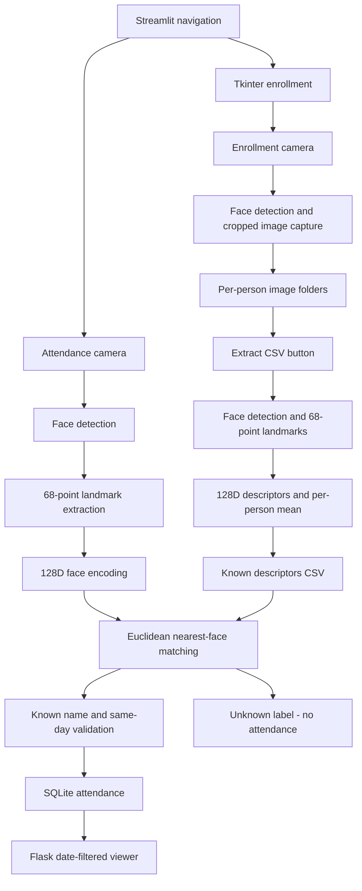

# Face Recognition-Based Smart Attendance System

A local Python application that replaces manual attendance entry with webcam-based face matching. Streamlit provides navigation, Tkinter handles enrollment, OpenCV displays recognition, and Flask lets users review attendance stored in SQLite.

The system uses **pretrained dlib models**, not a newly trained neural network. Enrollment produces averaged face descriptors; recognized names are recorded once per local calendar date.

## Demo Preview

**[Watch the existing screen recording](Demo/walkthrough.mp4)**

These are genuine captures from an earlier version, not new validation results. Button labels and messages may differ from the current code.

| Home | Face registration |
| --- | --- |
|  |  |
| Application navigation and feature list. | Name entry and capture controls; the camera is disabled in this capture. |
| Attendance confirmation | Attendance history |
|  |  |
| A previously captured attendance message, not an accuracy evaluation. | Date selection and a stored name/time record. |

There is no extraction screenshot in the existing gallery. The recording also shows native camera windows with a disabled camera, so it is not evidence of successful live enrollment or recognition.

## Key Features

- Named webcam enrollment with cropped image storage and input validation.
- Extraction of one mean 128-dimensional descriptor per person.
- Per-face recognition for multiple detected faces, with centroid tracking between classifications.
- Unknown-face labeling and attendance logging for matched names only.
- SQLite persistence with database-enforced same-name, same-date duplicate prevention.
- Date-filtered attendance history through a separate Flask viewer.
- Confirmed enrollment-data clearing; attendance history is retained.

## Technology Stack

| Technology | Responsibility |
| --- | --- |
| Python | Application logic and standard-library CSV/filesystem utilities |
| OpenCV | Camera capture, image conversion/cropping, recognition window |
| dlib | Frontal face detection, 68-point landmarks, pretrained face descriptors |
| NumPy | Descriptor averaging and Euclidean distance |
| pandas | Reading and validating saved descriptor rows |
| Streamlit | Home page and workflow navigation |
| Tkinter and Pillow | Native enrollment window and camera-image display |
| Flask and Jinja2 | Date-filtered attendance routes and HTML rendering |
| SQLite | Local attendance storage through `sqlite3` |
| HTML, CSS, Bootstrap | Attendance viewer presentation; Bootstrap loads from a CDN |

Dependencies are pinned in [requirements.txt](requirements.txt). The application loads the bundled `.dat` files directly; the installed `face_recognition_models` package is not imported by the active pipeline.

## System Architecture



Enrollment and recognition run on the computer hosting Python, not inside the browser. The CSV connects enrollment to recognition; SQLite connects the attendance taker to the independently started Flask viewer. Shared validation and storage functions live in `attendance_core.py`.

## How Face Recognition Works

1. dlib's frontal detector locates faces in RGB images. The landmark predictor estimates **68 facial landmarks**, and the recognition model generates a **128D descriptor** for each face.
2. Extraction accepts images containing exactly one detected face and averages valid descriptors for each enrollment folder. It replaces the CSV only after all enrolled people have usable descriptors.
3. Recognition selects the known descriptor with the smallest Euclidean distance. A match requires **distance < 0.4**; equality or a larger distance produces `unknown`. This configured threshold is not a measured accuracy value.
4. The camera loop supports several faces and uses centroid-based name tracking between classifications. It reclassifies periodically, at a configured interval of 10 frames.
5. Only matched names are submitted to storage. SQLite's `UNIQUE(name, date)` rule and conflict-aware insertion preserve the first attendance time for that name/date.

## Installation and Setup

The verified setup is **Windows x64 with CPython 3.11**. A desktop session, Tkinter, and a working default webcam (device `0`) are required for enrollment and live recognition. Enable camera access for desktop applications and close other programs using the camera.

From the repository root in **PowerShell**:

```powershell
python --version
python -m venv .venv
.\.venv\Scripts\python.exe -m pip install .\dlib-19.24.1-cp311-cp311-win_amd64.whl
.\.venv\Scripts\python.exe -m pip install -r requirements.txt
.\.venv\Scripts\python.exe -m pip check
```

The wheel is specific to CPython 3.11 on 64-bit Windows. Other operating systems and Python versions were not verified; they require a compatible dlib installation rather than this wheel. No environment variables or external database server are required.

Keep these included files in `data/data_dlib/`:

- `shape_predictor_68_face_landmarks.dat`
- `dlib_face_recognition_resnet_model_v1.dat`

The application creates enrollment directories and initializes the attendance table when needed. The repository directory must be writable. Data/model paths are anchored to the repository, rather than the terminal's current directory.

## Running the Application

Start Streamlit from the repository root:

```powershell
.\.venv\Scripts\python.exe -m streamlit run Main_page.py --server.address 127.0.0.1
```

Open [the Streamlit application](http://127.0.0.1:8501).

In a **second terminal**, start the attendance viewer:

```powershell
.\.venv\Scripts\python.exe app.py
```

Open [the Flask viewer](http://127.0.0.1:5000), or follow the Streamlit **Database** link. That link does not start Flask. Both services are local development servers; Flask debugging is disabled. Stop them with `Ctrl+C`.

## Step-by-Step Demo

1. **Register:** select **New Register**, then **Open registration camera**. Enter a distinct name and click **Input**. Keep one face inside the capture boundary, click **Save current face** for the images you want, and close the Tkinter window. Images appear under `data/data_faces_from_camera/person_<id>_<name>/`. See the [registration capture](Demo/registration.png). **Clear** is optional and destructive; confirmation is required.
2. **Extract:** select **Extraction** and click **Extract CSV**. A success message appears only after `data/features_all.csv` is written. Missing/invalid enrollment produces an error and preserves the previous CSV. Re-run extraction after enrolling new people.
3. **Recognize:** select **Attendance taker**, then **Start attendance camera**. Known faces can create an attendance record; unmatched faces remain `unknown`. Press `q` in the OpenCV window to stop. See the earlier [attendance confirmation](Demo/attendance-confirmation.png).
4. **Review:** with Flask running, select a date in the viewer and click **Show attendance**. Matching names and first-recorded times appear, or a no-data message is shown. See the [history capture](Demo/attendance-history.png).

Names identify people in both the CSV and attendance table. Use distinct names; this project has no separate student/employee identifier. New captures and descriptors should be generated only with the participants' permission.

## Project Structure

```text
face-recognition-attendance-system/
|-- Main_page.py          # Streamlit home
|-- pages/
|   |-- 1_Attendance_taker.py # Recognition, tracking, attendance
|   |-- 2_New_Register.py     # Tkinter enrollment and capture
|   |-- 3_Extraction.py       # Mean descriptor generation
|   `-- 4_Database.py         # Link to the Flask viewer
|-- attendance_core.py    # Paths, validation, matching, SQLite operations
|-- app.py                # Flask attendance viewer
|-- templates/           # Active Flask HTML template
|-- data/
|   |-- data_dlib/        # Bundled pretrained models
|   |-- data_faces_from_camera/ # Local enrollment images (ignored)
|   `-- features_all.csv  # Generated descriptors; existing tracked data remains
|-- Demo/                # Existing screenshots and recording
|-- Details/             # Older repository illustration and import notes
|-- tests/               # Webcam-free regression tests
|-- docs/VALIDATION.md    # Audit, validation scope, privacy/licensing notes
|-- requirements.txt     # Pinned dependencies
`-- dlib-19.24.1-cp311-cp311-win_amd64.whl
```

`attendance.db` is a local generated file. The root-level `index.html` is not used by Flask; `templates/index.html` is the active template.

## Data Storage

- **Images:** per-person directories containing captured JPEG files.
- **Descriptors:** headerless CSV; each row contains a name followed by 128 numeric values. The loader rejects empty, malformed, nonnumeric, nonfinite, all-zero, or duplicate-name entries.
- **Attendance:** `attendance.db`, with the schema below. Times and dates use the host computer's local clock.

```sql
CREATE TABLE IF NOT EXISTS attendance (
    name TEXT,
    time TEXT,
    date DATE,
    UNIQUE(name, date)
);
```

A unique `(name, date)` index also protects older compatible schemas. If an older database already contains duplicates, initialization reports an error rather than silently deleting history.

## Testing and Validation

Run the webcam-free suite and syntax checks:

```powershell
.\.venv\Scripts\python.exe -m unittest discover -s tests -v
.\.venv\Scripts\python.exe -m compileall -q Main_page.py app.py attendance_core.py pages tests
```

| Area | Verified scope |
| --- | --- |
| Enrollment | Name/folder validation, clear confirmation, failed reads/writes; camera mocked |
| Extraction | Mean calculation, preserved CSV on failure, button-triggered Streamlit execution; model outputs mocked |
| Recognition | Euclidean distance, nearest match, strict threshold boundary, multiple faces and unknown exclusion; camera/model mocked |
| Storage | Initialization, same-day uniqueness, next-day insertion, first-time preservation |
| Viewer | Date filtering, empty database, invalid dates, unavailable storage through Flask's test client |

The suite passed on Windows/Python 3.11; dependency checks and model loading also passed. Live enrollment and recognition with a consenting participant were **not revalidated**. Detailed evidence and remaining manual checks are in [docs/VALIDATION.md](docs/VALIDATION.md).

No validated performance metrics are currently documented in the repository.

## Limitations and Future Improvements

- Requires a local desktop/webcam; this is not a browser-camera or hosted deployment.
- Lighting, pose, occlusion, and similar appearances can affect matching. There is no liveness detection or anti-spoofing.
- Centroid tracking can associate names incorrectly when faces cross; multiple-face support is not a measured reliability guarantee.
- No authentication, roles, encryption, identity management, or production deployment configuration is implemented.
- Future work could add consent-based evaluation, liveness checks, stronger identity/tracking, access control, and a reviewed deployment setup. These are not current features.

## Privacy and Model Notices

Existing tracked descriptors are named biometric data. Ignoring generated files does **not** remove already tracked data or Git history. Existing demo media includes personal names, and the separate server-log capture contains a debugger PIN. Review consent and sanitize public evidence before sharing; see the [maintainer remediation notes](docs/VALIDATION.md#privacy-and-repository-hygiene). No existing biometric data or history was deleted by this update.

The bundled model filenames correspond to [dlib's pretrained models](https://github.com/davisking/dlib-models). Upstream flags a commercial-use restriction associated with the 68-point model's training dataset; review that notice before reuse. dlib's library uses the [Boost Software License](https://github.com/davisking/dlib/blob/master/dlib/LICENSE.txt). These notices do not license this repository: no project-level license or verifiable provenance record for the bundled wheel/models is included. The wheel and models are retained for the existing Windows setup.

